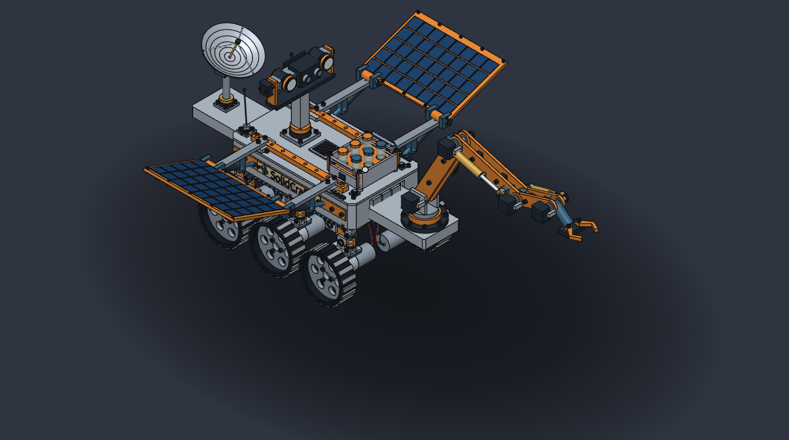
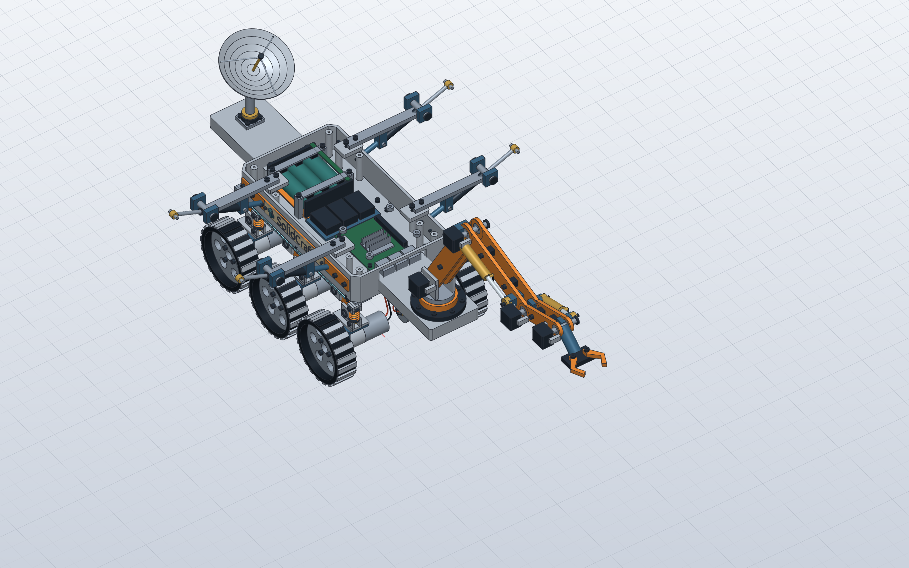

# SolidCraft Scientific Rover

A scientific rover built entirely through **SolidCraft's native MCP commands**. An editable CAD showcase, a reusable media kit, and a public workload for investigating large-document performance.

The rover has six driven wheels, visible suspension and dampers, an articulated sampling arm, a camera and lighting turret, deployable solar panels, a steerable dish, sample vials, rechargeable-cell holders, a simplified Raspberry Pi 5 and motor wiring. It is an illustrative assembly with credible mounting details, not a manufacturing-certified or space-qualified design.

## Download

- **[Complete release](https://github.com/0xlillith/solidcraft-rover/releases/tag/v1.0.0)**: native models, STEP, 3MF, all photos, GIFs and MP4s.
- **[Editable rover](https://github.com/0xlillith/solidcraft-rover/releases/download/v1.0.0/Rover-v7.solidcraft)**: the approved v7 assembly, with its native feature history and joints.
- **[Everything in one ZIP](https://github.com/0xlillith/solidcraft-rover/releases/download/v1.0.0/SolidCraft-rover-complete-kit.zip)**: models, exchange exports, media and licence information.
- [Media-only ZIP](MEDIAhttps://github.com/0xlillith/solidcraft-rover/releases/download/v1.0.0/SolidCraft-rover-complete-kit.zip): 16 PNGs, two GIFs, two MP4s and an offline gallery.
- [Construction-recording model](https://github.com/0xlillith/solidcraft-rover/releases/download/v1.0.0/Rover-recorded.solidcraft): the separately reconstructed variant shown in the timelapse.

Open the native `.solidcraft` model with [SolidCraft 0.7.0](https://github.com/bherbruck/solidcraft/releases/tag/v0.7.0), the version used to create and validate these assets. STEP and 3MF exports are also available in the release; they do not preserve the native modelling history.

## Use it on a website, splash screen or presentation

The model and original media are available under **MIT OR Apache-2.0**. You can reuse, crop, adapt and redistribute them under either licence. Keep the applicable licence and attribution with your distribution; [ATTRIBUTION.md](ATTRIBUTION.md) covers the SolidCraft emblem and Ubuntu Light lettering. Suggested credit: `SolidCraft rover by 0xlillith, built through MCP in SolidCraft`.

This is a community contribution. The emblem identifies SolidCraft; the artwork does not imply official adoption or endorsement.

| View | Clean render | App interface | Dark background |
|---|---|---|---|
| Main exterior | [PNG](images/01-exterior-hero.png) | [PNG](images/01-exterior-hero-interface.png) | [PNG](images/01-exterior-hero-studio.png) |
| Rear angle | [PNG](images/02-rear-emblem.png) | [PNG](images/02-rear-emblem-interface.png) | [PNG](images/02-rear-emblem-studio.png) |
| General plan | [PNG](images/03-plan.png) | [PNG](images/03-plan-interface.png) | — |
| Open electronics bay | [PNG](images/04-open-avionics.png) | [PNG](images/04-open-avionics-interface.png) | [PNG](images/04-open-avionics-studio.png) |
| Interior plan | [PNG](images/05-interior-plan.png) | [PNG](images/05-interior-plan-interface.png) | — |
| Suspension | [PNG](images/06-suspension-detail.png) | — | — |
| Camera and lights | [PNG](images/07-camera-head.png) | — | — |
| Sample cassette | [PNG](images/08-sample-cassette.png) | — | — |

General renders are 2560 × 1600; detail renders are 2400 × 1800. Interface captures are 1800 × 1118. Dark-background variants are 1360 × 760 crops of the actual viewport. Interior views hide roof-mounted assemblies to expose the existing electronics. The isolated suspension view omits chassis fasteners whose mating structure is outside the view.

## Animations

| Animation | GIF | MP4 |
|---|---|---|
| Exterior and interior showcase | [13.51 s · 9.8 MB](https://github.com/0xlillith/solidcraft-rover/releases/download/v1.0.0/SolidCraft-rover-short.gif) | [Higher-detail video](https://github.com/0xlillith/solidcraft-rover/releases/download/v1.0.0/SolidCraft-rover-showcase.mp4) |
| Full MCP construction, with interface | [39.66 s · 6.3 MB](https://github.com/0xlillith/solidcraft-rover/releases/download/v1.0.0/SolidCraft-rover-build.gif) | [Higher-detail video](https://github.com/0xlillith/solidcraft-rover/releases/download/v1.0.0/SolidCraft-rover-build.mp4) |

The construction clip uses 379 screenshots from a fresh native MCP build, with sampled frames and edited timing. It pauses on the electronics, finishes the assembly, then reveals the interior again. It is an accelerated construction sequence, not a real-time performance measurement. All source images come from SolidCraft; editing only sequences, crops, resizes, adds brief dissolves and encodes the frames. No AI-generated replacement imagery is used.

## How large is it?

| Metric | Approved v7 model |
|---|---:|
| Solid bodies | 1,395 |
| Sketches / sketch curves | 576 / 3,792 |
| Component definitions | 36 + root assembly |
| Revolute joints | 17 |
| History entries | 3,324 |
| Body-transfer entries included in that history | 1,395 |
| Display triangles in the 0.7.0 CLI probe | 1,025,680 |
| Native file size | 216,036 bytes |

The history includes 545 extrusions, 498 cylinders, 254 boxes, 15 sweeps, 12 fillets, 6 coils, 6 circular patterns, 2 shells, 1 revolve and 14 moves. The recorded variant has 3,323 history entries and 13 moves: the final suspension placement is built directly rather than appended as a corrective move. Keep these fixtures distinct when comparing measurements.

[model-stats.json](model-stats.json) contains the counts and native-file SHA-256 hashes. Feature evaluation and joint inspection reported no errors/conflicts for the saved poses; this does not validate every possible articulated pose.

## Performance workload

The file is small, but opening it rebuilds a large editable assembly. It is useful for separating file decoding, geometry evaluation, component placement, display meshing and viewport interaction.

See the [benchmark proposal and reproduction protocol](benchmark/README.md) and the [initial raw measurements](benchmark/results). This workload complements small synthetic fixtures; it is not representative of every CAD design, Boolean-heavy model or STEP import.

## Provenance and licensing

Created with SolidCraft 0.7.0 through MCP, with design direction and iteration by 0xlillith and AI-assisted modelling/automation. This repository contains original model/media assets, not manufacturer CAD. The Raspberry Pi and battery geometry is simplified. See [ATTRIBUTION.md](ATTRIBUTION.md), [LICENSE-MIT](LICENSE-MIT), [LICENSE-APACHE](LICENSE-APACHE) and [UFL.txt](UFL.txt).
